# Projet Med-RDV - Plateforme de Prise de Rendez-vous Médicaux

## Description du projet
Med-RDV est un agenda médical multi-praticiens basé sur une architecture microservices.
Le système permet à un patient de réserver un créneau, au praticien de consulter le dossier de synthèse (allergies, antécédents) avant la consultation, et met à jour le dossier patient à la fin de la consultation.
L'unité de traitement principale est le Rendez-vous, qui suit un cycle de vie strict : DEMANDE ➔ CONFIRME ➔ REALISE / ANNULE.

## Diagramme de Classes UML Global
Ce diagramme présente les entités de chaque service métier. Les interactions entre services sont matérialisées par des flèches de dépendance en pointillés.

## Schéma de l'Architecture
L'architecture est composée des applications Spring Boot suivantes :

| Application | Rôle | Port |
| :--- | :--- | :--- |
| **eureka-server** | Service Registry (annuaire dynamique) | `8761` |
| **config-server** | Serveur de configuration centralisé | `8888` |
| **gateway-service** | API Gateway (point d'entrée unique, routage) | `8080` |
| **service-patients** | Gestion des patients et dossiers médicaux | `8081` |
| **service-praticiens** | Gestion des praticiens et des créneaux | `8082` |
| **service-rendezvous** | Gestion du cycle de vie des rendez-vous | `8083` |

---

## Jalon V2 : Eureka et Gateway (Routage Dynamique)

### Dépendances ajoutées
*   `spring-cloud-starter-netflix-eureka-server` : Annuaire de services (Eureka).
*   `spring-cloud-starter-netflix-eureka-client` : Permet aux services de s'enregistrer sur Eureka.
*   `spring-cloud-starter-gateway-server-webflux` : Point d'entrée unique (API Gateway).
*   `spring-boot-starter-actuator` : Permet d'observer l'état des applications et les routes générées.
*   `spring-cloud-starter-loadbalancer` : Pour la répartition de charge via la Gateway.

### Preuves de fonctionnement
**1. Tableau de bord Eureka :**
On y voit les services enregistrés (Gateway, Patients, Praticiens, Rendezvous).
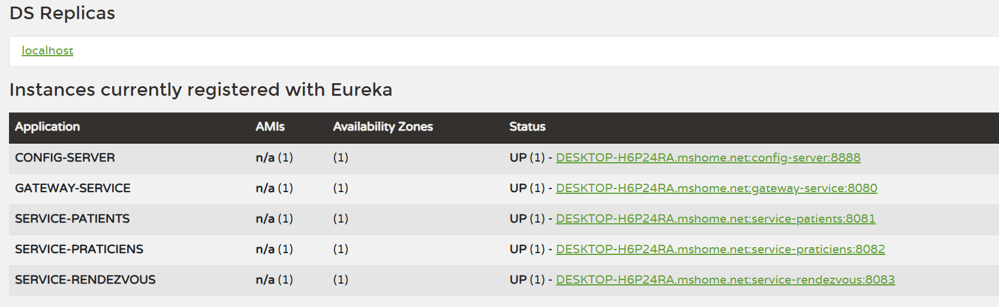

**2. Test de routage dynamique via Postman :**
L'appel à `/service-patients/patients` via la Gateway (port 8080) est bien redirigé vers le microservice.
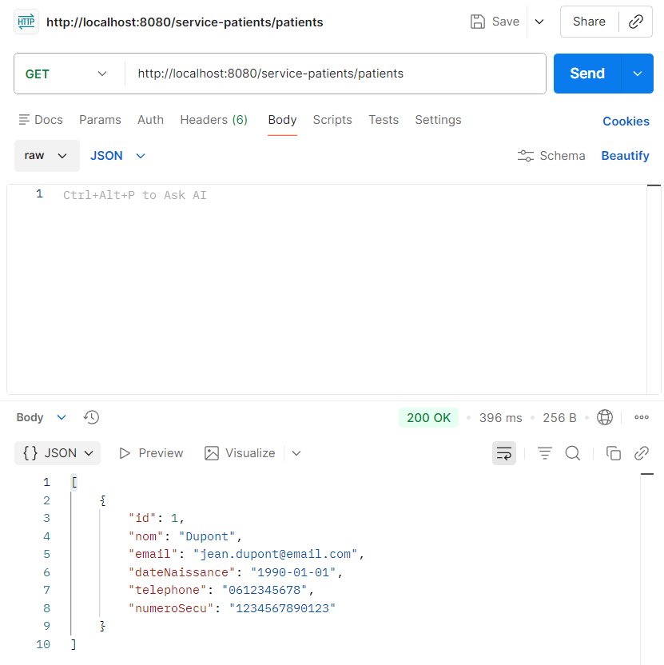

**3. Observation des routes via Actuator :**
L'URL `/actuator/gateway/routes` montre les routes statiques (Rate Limiter) et dynamiques (générées par Eureka).
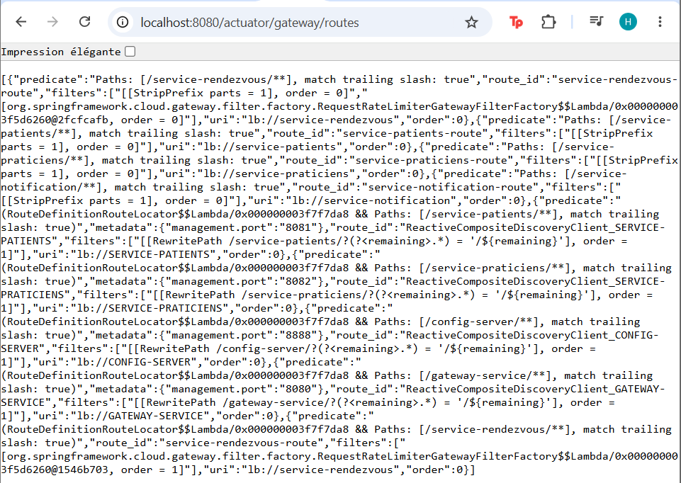

**4. Métriques de la Gateway :**
La métrique `spring.cloud.gateway.requests` prouve que la Gateway compte bien les requêtes traitées.
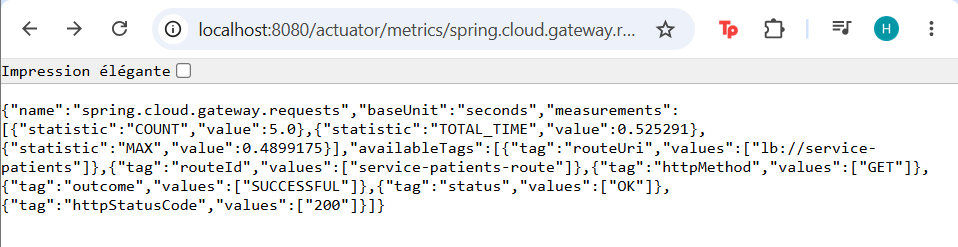

### Expérience : Détection Automatique
*   **Action :** J'ai arrêté le service `service-patients`.
*   **Observation :** La route `SERVICE-PATIENTS` a disparu de l'URL `/actuator/gateway/routes` après environ 30 secondes.
*   **Action :** J'ai redémarré `service-patients` sans toucher à la Gateway.
*   **Observation :** La route est réapparue automatiquement après 30 secondes. La Gateway s'adapte dynamiquement.

### Question théorique
**Pourquoi le serveur Eureka ne s'enregistre-t-il pas lui-même ?**
> *"Eureka est l'annuaire central. S'il s'enregistrait lui-même, il tenterait de se découvrir, ce qui créerait une boucle logique inutile et consommerait des ressources sans valeur ajoutée pour l'architecture."*

---

## Jalon V3 : Config Server et Centralisation

La configuration a été externalisée dans un dépôt Git (dossier `config-repo`) et est servie par un Spring Cloud Config Server (port 8888).

### 1. Structure du config-repo
*   **application.properties** (Global) : Contient les configurations communes (Eureka, Actuator).
*   **{service}.properties** (Spécifique) : Contient les configurations propres à chaque service (port, base de données, routes Gateway).

### 2. Preuve de l'agrégation
L'appel `GET http://localhost:8888/service-rendezvous/default` démontre l'agrégation : le Config Server renvoie une liste `propertySources` contenant d'abord les propriétés spécifiques du service, puis les propriétés globales.
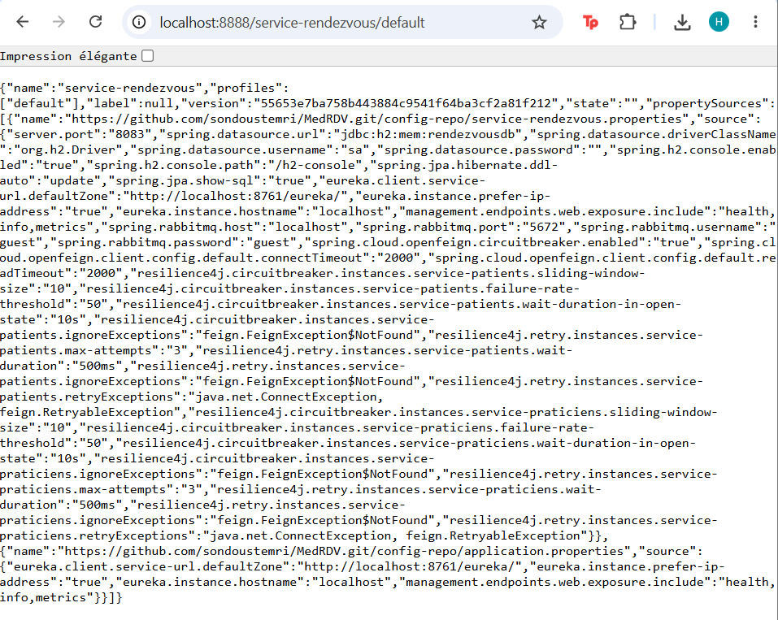

### 3. Tests de bout en bout (Config centralisée)
Puisque les fichiers locaux sont vides (hors `spring.config.import`), les services récupèrent bien leurs ports et bases de données depuis GitHub.
*   **Test direct :**
    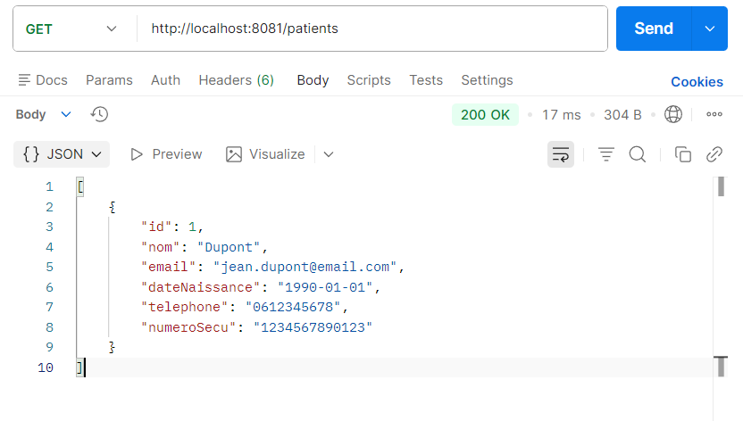
*   **Test via Gateway :**
    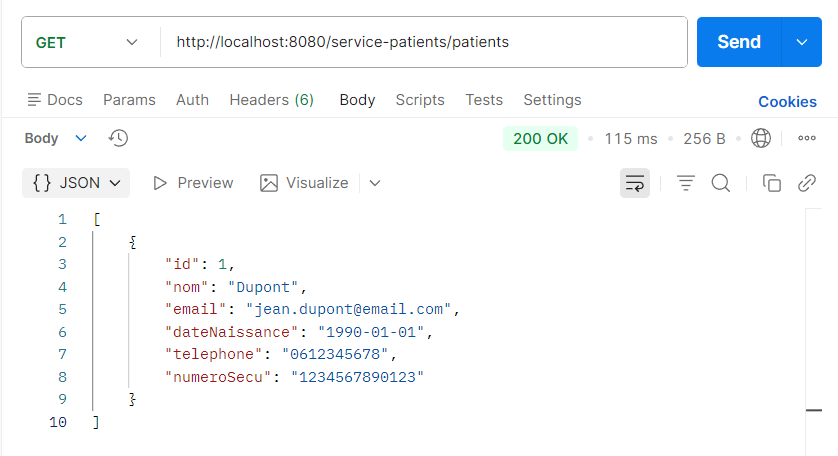

### 4. Problème d'amorçage (Bootstrap Problem)
Les services `eureka-server` et `config-server` conservent leur configuration en local. En effet, si le Config Server était lui-même configuré à distance, les services ne pourraient pas démarrer correctement (dépendance circulaire). Les autres services n'ont plus aucune configuration métier en local.

---

## Jalon V4 : OpenFeign et Idempotence

Le service `service-rendezvous` utilise **OpenFeign** pour valider l'existence du patient, du docteur et du créneau avant d'enregistrer un rendez-vous. Une **clé d'idempotence** est requise dans le Header pour éviter les doubles réservations.

### Preuves de fonctionnement
**1. Création réussie avec Idempotence :**
La clé `Idempotency-Key` est envoyée dans le Header. Le rendez-vous est créé (201 Created).
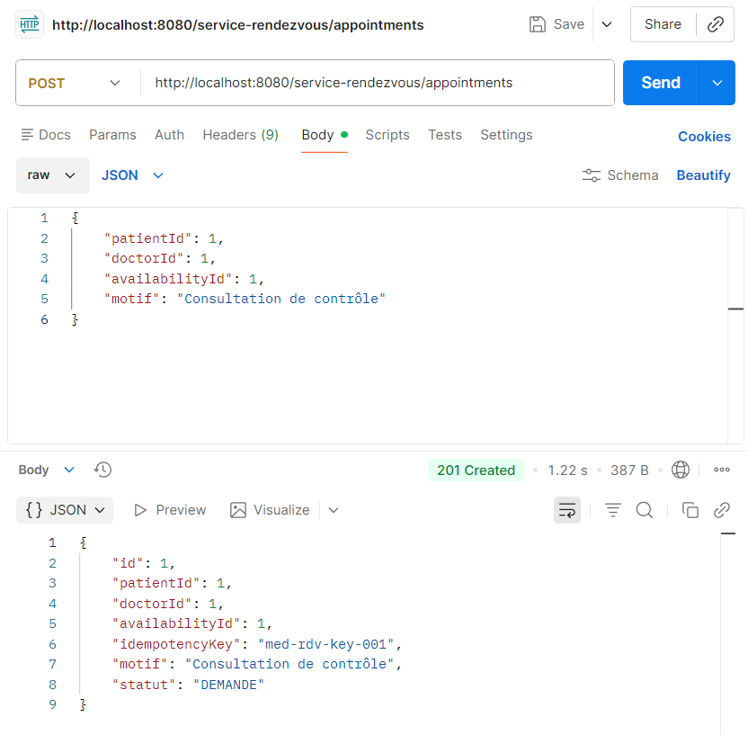

**2. Rejet de doublon (Idempotence) :**
Une deuxième requête avec la même clé renvoie une erreur 400 Bad Request "Opération déjà traitée".
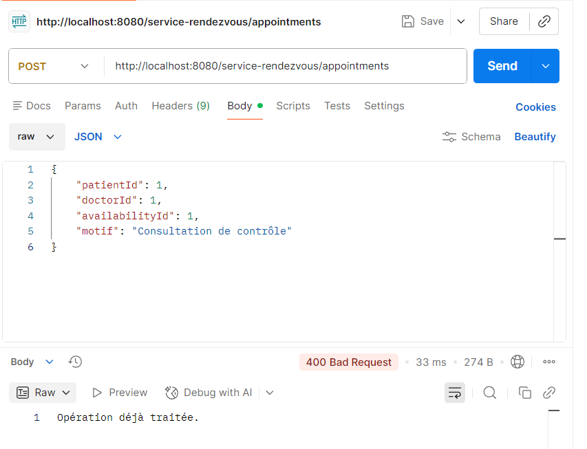

**3. Ressource introuvable (OpenFeign 404) :**
Si on envoie un ID de patient qui n'existe pas (ex: 99), OpenFeign renvoie une erreur gérée par le `GlobalExceptionHandler` (404 Not Found).
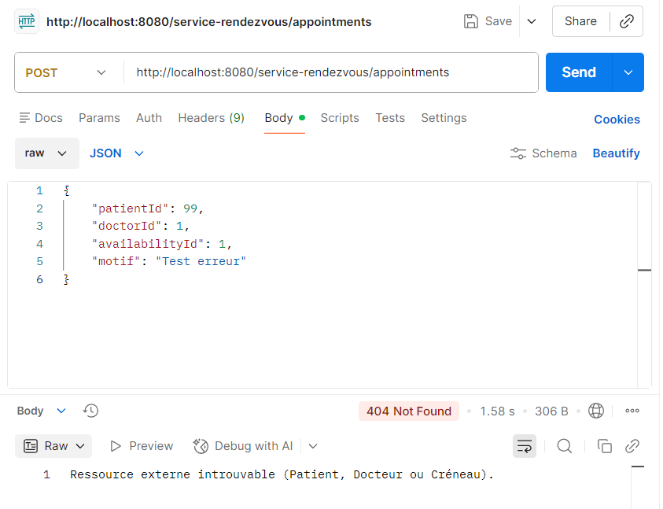

**4. Consultation Enrichie :**
L'endpoint `/enriched` agrège les données du rendez-vous, du patient, du dossier médical, du docteur et du créneau en une seule requête.
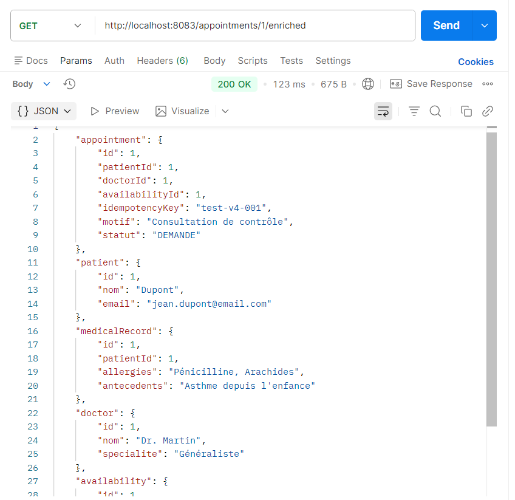
---

## Prérequis et Instructions de lancement

### Prérequis
*   Java 17 (JDK)
*   Maven 3.8+
*   IntelliJ IDEA
*   Postman

### Instructions de lancement
1. Cloner le dépôt : `git clone https://github.com/sondoustemri/MedRDV.git`
2. Ouvrir le projet dans IntelliJ IDEA et recharger les dépendances Maven.
3. Démarrer les applications dans cet ordre strict :
   1.  `eureka-server` (attendre qu'il soit prêt sur http://localhost:8761)
   2.  `config-server` (attendre qu'il soit prêt sur http://localhost:8888)
   3.  `service-patients`
   4.  `service-praticiens`
   5.  `service-rendezvous`
   6.  `gateway-service`