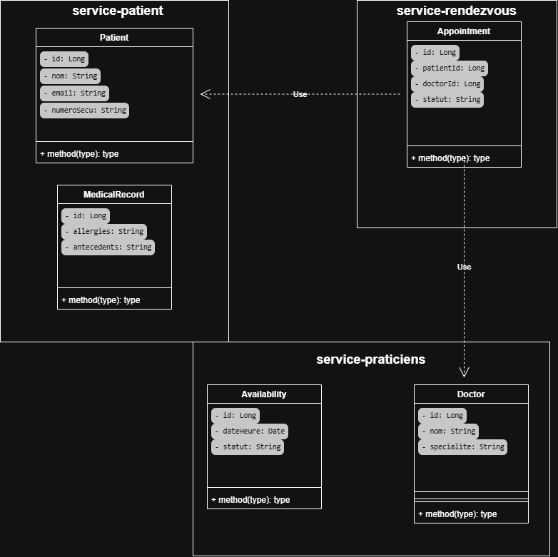
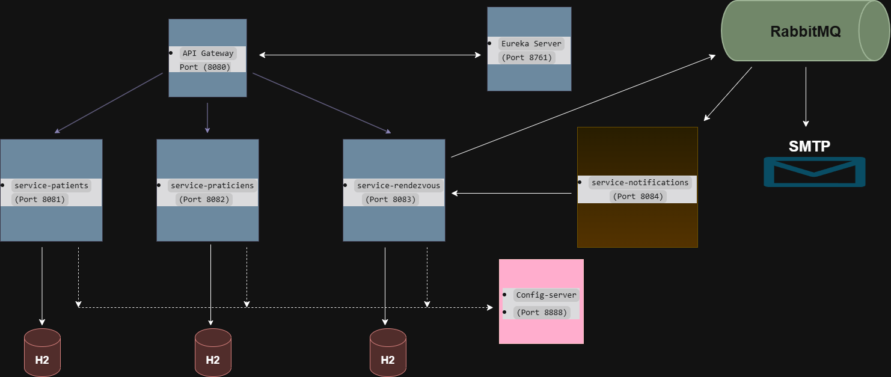

# Projet Med-RDV - Plateforme de Prise de Rendez-vous Médicaux

## Description du projet
Med-RDV est un agenda médical multi-praticiens basé sur une architecture microservices.
Le système permet à un patient de réserver un créneau, au praticien de consulter le dossier de synthèse (allergies, antécédents) avant la consultation, et met à jour le dossier patient à la fin de la consultation.
L'unité de traitement principale est le Rendez-vous, qui suit un cycle de vie strict : DEMANDE ➔ CONFIRME ➔ REALISE / ANNULE.

## Diagramme de Classes UML Global
Ce diagramme présente les entités de chaque service métier. Les interactions entre services sont matérialisées par des flèches de dépendance en pointillés.

## Schéma de l'Architecture
L'architecture est composée des applications Spring Boot suivantes :

| Application | Rôle | Port |
| :--- | :--- | :--- |
| **eureka-server** | Service Registry (annuaire dynamique) | `8761` |
| **config-server** | Serveur de configuration centralisé | `8888` |
| **gateway-service** | API Gateway (point d'entrée unique, routage) | `8080` |
| **service-patients** | Gestion des patients et dossiers médicaux | `8081` |
| **service-praticiens** | Gestion des praticiens et des créneaux | `8082` |
| **service-rendezvous** | Gestion du cycle de vie des rendez-vous | `8083` |

## Dépendances ajoutées et leur rôle (Jalon V2)
*   `spring-cloud-starter-netflix-eureka-server` : Annuaire de services (Eureka).
*   `spring-cloud-starter-netflix-eureka-client` : Permet aux services de s'enregistrer sur Eureka.
*   `spring-cloud-starter-gateway-server-webflux` : Point d'entrée unique (API Gateway).
*   `spring-boot-starter-actuator` : Permet d'observer l'état des applications et les routes générées.
*   `spring-cloud-starter-loadbalancer` : Pour la répartition de charge via la Gateway.

## Expérience : Détection Automatique (Jalon V2)
*   **Action :** J'ai arrêté le service `service-patients`.
*   **Observation :** La route `SERVICE-PATIENTS` a disparu de l'URL `/actuator/gateway/routes` après environ 30 secondes.
*   **Action :** J'ai redémarré `service-patients` sans toucher à la Gateway.
*   **Observation :** La route est réapparue automatiquement après 30 secondes. La Gateway s'adapte dynamiquement à l'état d'Eureka.

## Question théorique
**Pourquoi le serveur Eureka ne s'enregistre-t-il pas lui-même ?**
> *"Eureka est l'annuaire central. S'il s'enregistrait lui-même, il tenterait de se découvrir, ce qui créerait une boucle logique inutile et consommerait des ressources sans valeur ajoutée pour l'architecture."*

## Prérequis et Instructions de lancement

### Prérequis
*   Java 17 (JDK)
*   Maven 3.8+
*   IntelliJ IDEA
*   Postman ou Swagger

### Instructions de lancement
1. Cloner le dépôt : `git clone https://github.com/sondoustemri/MedRDV.git`
2. Ouvrir le projet dans IntelliJ IDEA et recharger les dépendances Maven.
3. Démarrer les applications dans cet ordre strict :
   1.  `eureka-server` (attendre qu'il soit prêt sur http://localhost:8761)
   2.  `config-server` (attendre qu'il soit prêt sur http://localhost:8888)
   3.  `service-patients`
   4.  `service-praticiens`
   5.  `service-rendezvous`
   6.  `gateway-service`