# Projet Med-RDV - Plateforme de Prise de Rendez-vous Médicaux

## Description du projet
Med-RDV est un agenda médical multi-praticiens basé sur une architecture microservices.
Le système permet à un patient de réserver un créneau, au praticien de consulter le dossier de synthèse (allergies, antécédents) avant la consultation, et met à jour le dossier patient à la fin de la consultation.
L'unité de traitement principale est le Rendez-vous, qui suit un cycle de vie strict : DEMANDE ➔ CONFIRME ➔ REALISE / ANNULE.

## Diagramme de Classes UML Global
Ce diagramme présente les entités de chaque service métier. Les interactions entre services sont matérialisées par des flèches de dépendance en pointillés.

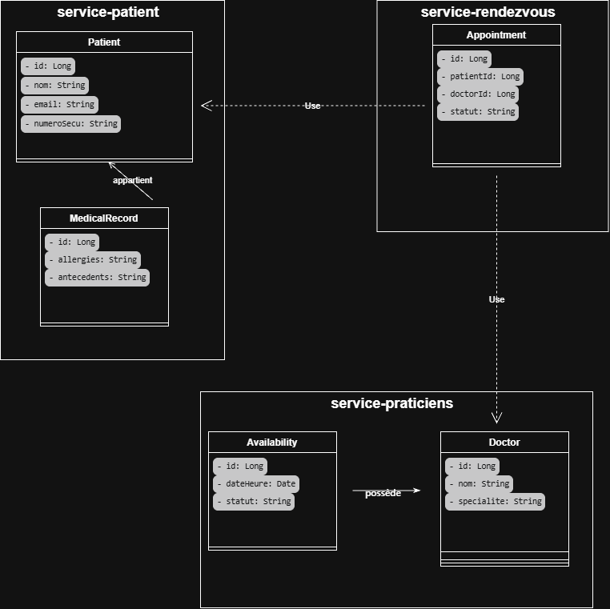

## Schéma de l'Architecture
L'architecture est composée des applications Spring Boot suivantes :

| Application | Rôle | Port |
| :--- | :--- | :--- |
| **eureka-server** | Service Registry (annuaire dynamique) | `8761` |
| **config-server** | Serveur de configuration centralisé | `8888` |
| **gateway-service** | API Gateway (point d'entrée unique, routage) | `8080` |
| **service-patients** | Gestion des patients et dossiers médicaux | `8081` |
| **service-praticiens** | Gestion des praticiens et des créneaux | `8082` |
| **service-rendezvous** | Gestion du cycle de vie des rendez-vous | `8083` |
| **service-notification** | Gestion des notifications asynchrones (RabbitMQ + SMTP) | `8084` |

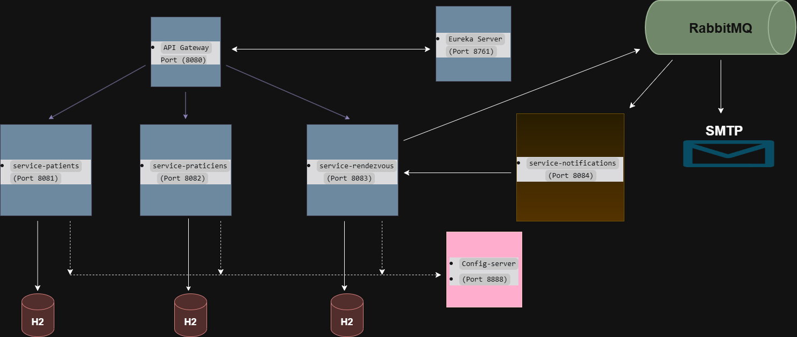

---

## Jalon V2 : Eureka et Gateway (Routage Dynamique)

### Dépendances ajoutées
*   `spring-cloud-starter-netflix-eureka-server` : Annuaire de services (Eureka).
*   `spring-cloud-starter-netflix-eureka-client` : Permet aux services de s'enregistrer sur Eureka.
*   `spring-cloud-starter-gateway-server-webflux` : Point d'entrée unique (API Gateway).
*   `spring-boot-starter-actuator` : Permet d'observer l'état des applications et les routes générées.
*   `spring-cloud-starter-loadbalancer` : Pour la répartition de charge via la Gateway.

### Preuves de fonctionnement
**1. Tableau de bord Eureka :**
On y voit les services enregistrés (Gateway, Patients, Praticiens, Rendezvous).
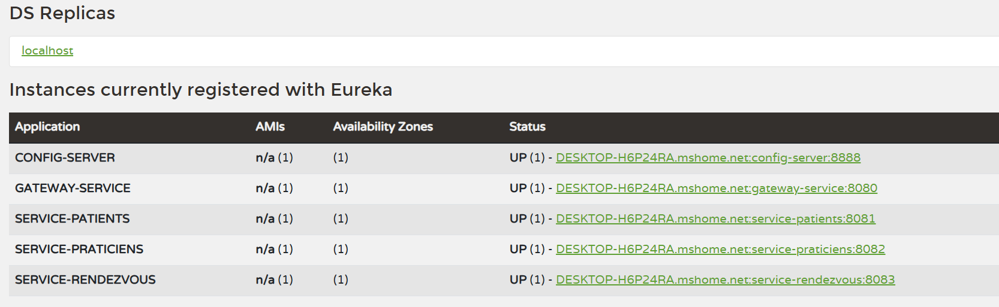

**2. Test de routage dynamique via Postman :**
L'appel à `/service-patients/patients` via la Gateway (port 8080) est bien redirigé vers le microservice.
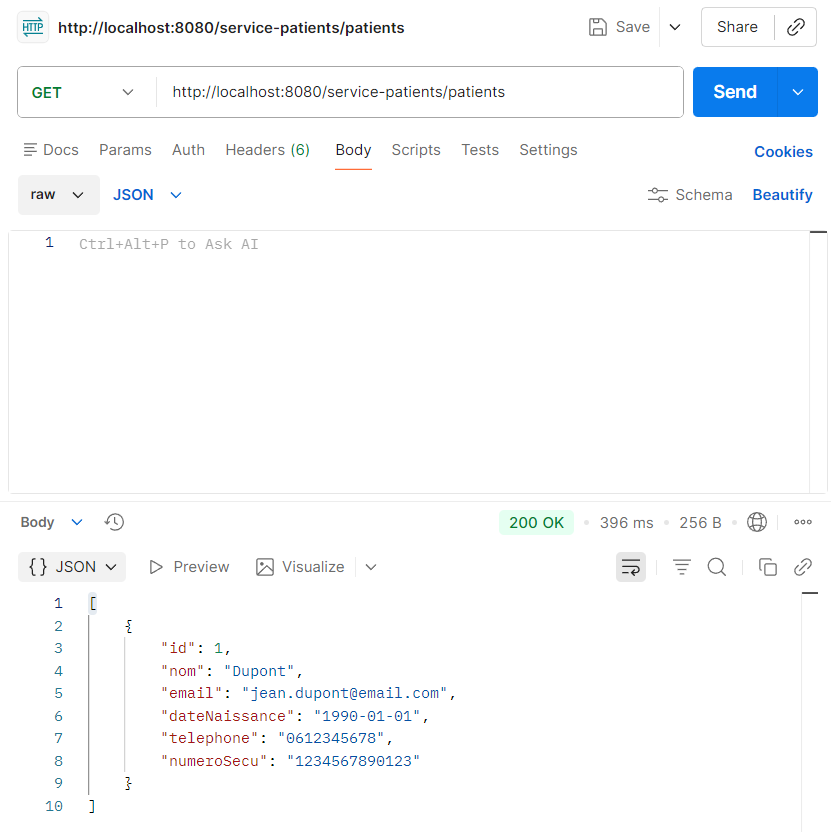

**3. Observation des routes via Actuator :**
L'URL `/actuator/gateway/routes` montre les routes statiques (Rate Limiter) et dynamiques (générées par Eureka).
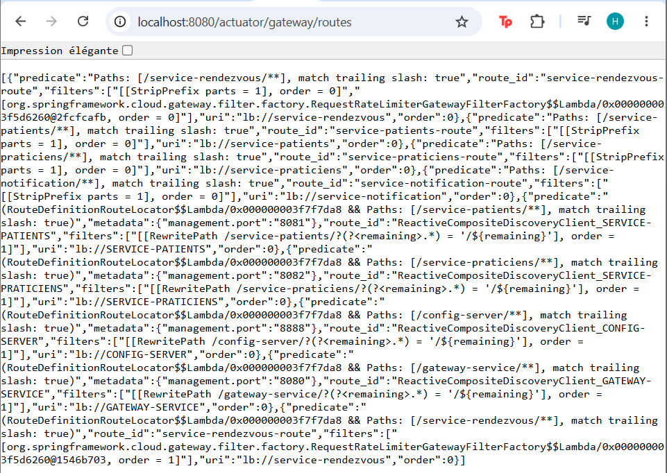

**4. Métriques de la Gateway :**
La métrique `spring.cloud.gateway.requests` prouve que la Gateway compte bien les requêtes traitées.
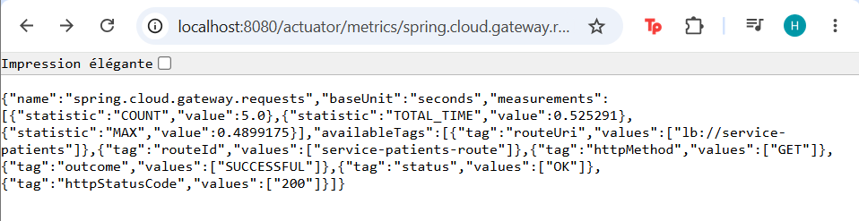

### Expérience : Détection Automatique
*   **Action :** J'ai arrêté le service `service-patients`.
*   **Observation :** La route `SERVICE-PATIENTS` a disparu de l'URL `/actuator/gateway/routes` après environ 30 secondes.
*   **Action :** J'ai redémarré `service-patients` sans toucher à la Gateway.
*   **Observation :** La route est réapparue automatiquement après 30 secondes. La Gateway s'adapte dynamiquement.

### Question théorique
**Pourquoi le serveur Eureka ne s'enregistre-t-il pas lui-même ?**
> *"Eureka est l'annuaire central. S'il s'enregistrait lui-même, il tenterait de se découvrir, ce qui créerait une boucle logique inutile et consommerait des ressources sans valeur ajoutée pour l'architecture."*

## Test du Load Balancing (Répartition de charge)

Pour valider la répartition de charge (Load Balancing) gérée par Spring Cloud LoadBalancer via la Gateway, nous avons déployé deux instances du microservice `service-patients` sur des ports différents.

### 1. Création de la deuxième instance
Dans IntelliJ IDEA, nous avons dupliqué la configuration de lancement de `ServicePatientsApplication` et ajouté l'argument de programme `--server.port=8084` dans les *Program arguments*.
*   **Instance 1** : `http://localhost:8081`
*   **Instance 2** : `http://localhost:8084`

Une fois les deux instances lancées, le tableau de bord Eureka (`http://localhost:8761`) affiche bien deux instances enregistrées pour le service `SERVICE-PATIENTS`.

### 2. Test et visualisation
Dans Postman, nous avons envoyé plusieurs requêtes successives (clics répétés sur "Send") sur l'URL de la Gateway :
👉 `GET http://localhost:8080/service-patients/patients`

En observant simultanément les consoles d'IntelliJ des deux instances, on constate une **alternance des requêtes** (Round-Robin) :
*   La première requête s'affiche dans la console de l'instance tournant sur le port **8081**.
*   La requête suivante s'affiche dans la console de l'instance tournant sur le port **8084**.
*   Et ainsi de suite.

**Conclusion :** La Gateway distribue équitablement le trafic entre les instances disponibles, garantissant ainsi la haute disponibilité et la montée en charge (scalabilité horizontale) de l'architecture.

---

## Jalon V3 : Config Server et Centralisation

La configuration a été externalisée dans un dépôt Git (dossier `config-repo`) et est servie par un Spring Cloud Config Server (port 8888).

### 1. Structure du config-repo
*   **application.properties** (Global) : Contient les configurations communes (Eureka, Actuator).
*   **{service}.properties** (Spécifique) : Contient les configurations propres à chaque service (port, base de données, routes Gateway).

### 2. Preuve de l'agrégation
L'appel `GET http://localhost:8888/service-rendezvous/default` démontre l'agrégation : le Config Server renvoie une liste `propertySources` contenant d'abord les propriétés spécifiques du service, puis les propriétés globales.
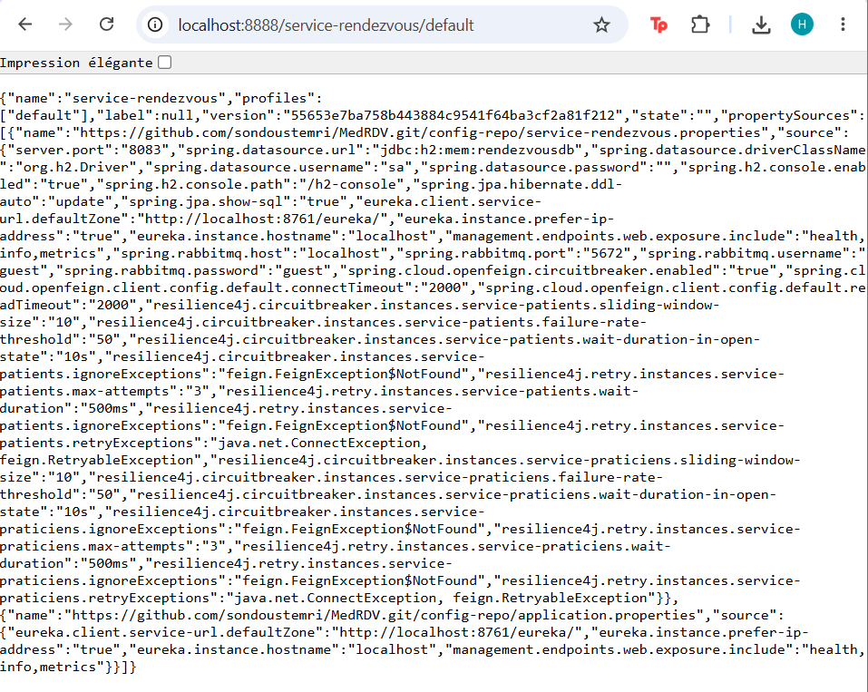

### 3. Tests de bout en bout (Config centralisée)
Puisque les fichiers locaux sont vides (hors `spring.config.import`), les services récupèrent bien leurs ports et bases de données depuis GitHub.
*   **Test direct :**
    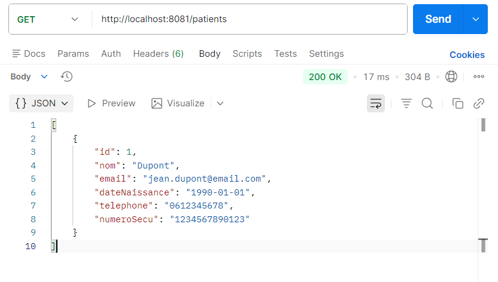
*   **Test via Gateway :**
    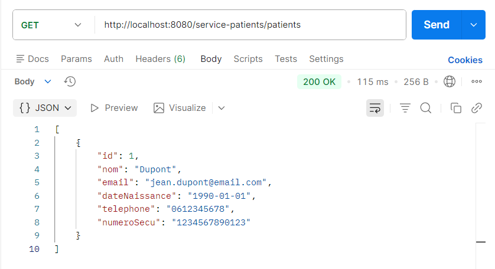

### 4. Problème d'amorçage (Bootstrap Problem)
Les services `eureka-server` et `config-server` conservent leur configuration en local. En effet, si le Config Server était lui-même configuré à distance, les services ne pourraient pas démarrer correctement (dépendance circulaire). Les autres services n'ont plus aucune configuration métier en local.

---

## Jalon V4 : OpenFeign et Idempotence

Le service `service-rendezvous` utilise **OpenFeign** pour valider l'existence du patient, du docteur et du créneau avant d'enregistrer un rendez-vous. Une **clé d'idempotence** est requise dans le Header pour éviter les doubles réservations.

### Preuves de fonctionnement
**1. Création réussie avec Idempotence :**
La clé `Idempotency-Key` est envoyée dans le Header. Le rendez-vous est créé (201 Created).
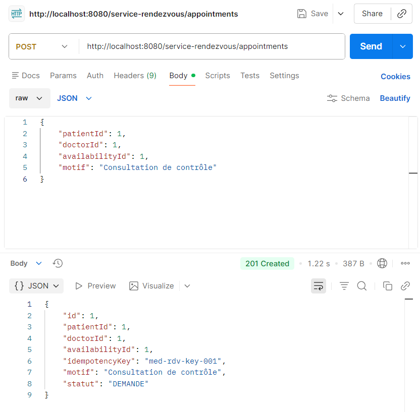

**2. Rejet de doublon (Idempotence) :**
Une deuxième requête avec la même clé renvoie une erreur 400 Bad Request "Opération déjà traitée".
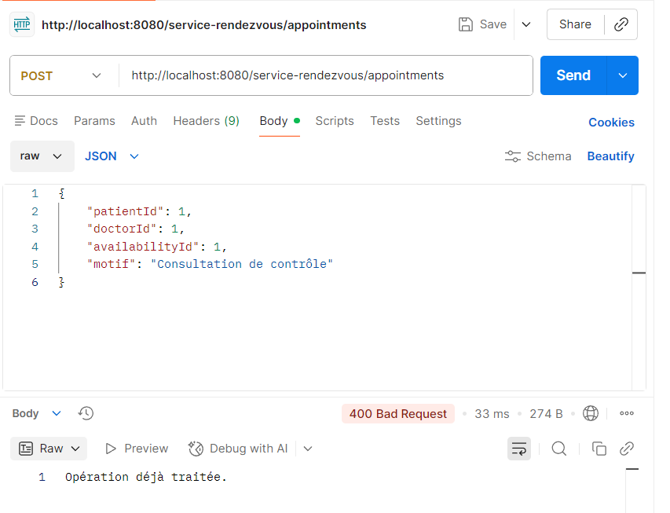

**3. Ressource introuvable (OpenFeign 404) :**
Si on envoie un ID de patient qui n'existe pas (ex: 99), OpenFeign renvoie une erreur gérée par le `GlobalExceptionHandler` (404 Not Found).
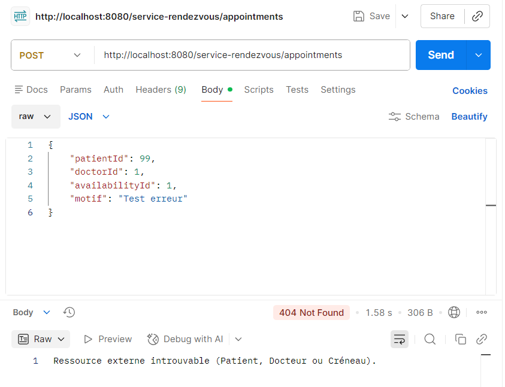

**4. Consultation Enrichie :**
L'endpoint `/enriched` agrège les données du rendez-vous, du patient, du dossier médical, du docteur et du créneau en une seule requête.
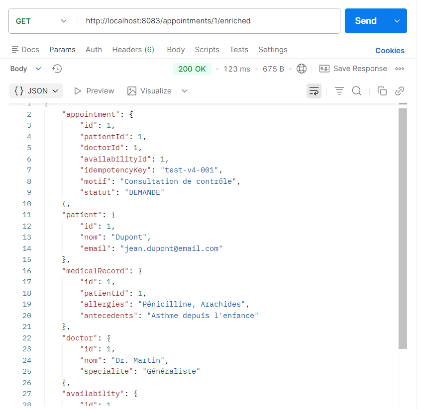
---

## Jalon V5 : Notifications Asynchrones avec RabbitMQ

Ce jalon ajoute une communication asynchrone entre `service-rendezvous` (producteur) et `service-notification` (consommateur) via RabbitMQ. Après la confirmation d'un rendez-vous, un message JSON est publié dans une file d'attente, et le service de notification envoie un email via un serveur SMTP local (Mailpit).

### Architecture du parcours de notification


*   **Producteur** : `service-rendezvous` (port 8083) publie un message JSON après le commit de la transaction.
*   **Broker** : RabbitMQ (port 5672 pour AMQP, 15672 pour l'interface web).
*   **File d'attente** : `rendezvous.notification.queue`
*   **Consommateur** : `service-notification` (port 8084) consomme le message et envoie l'email.
*   **Serveur SMTP** : Mailpit (port 1025 pour SMTP, 8025 pour l'interface web).
###  Dépendances ajoutées

Pour implémenter cette communication asynchrone et l'envoi d'emails, nous avons ajouté les dépendances suivantes :

*   **Dans `service-rendezvous` et `service-notification` :**
    `spring-boot-starter-amqp` (pour la communication avec RabbitMQ).
*   **Dans `service-notification` :**
    `spring-boot-starter-mail` (pour l'envoi d'emails via JavaMailSender).
* 
###  Commandes Docker

**1. Lancer RabbitMQ :**

`docker run -d --name rabbitmq -p 5672:5672 -p 15672:15672 rabbitmq:3-management`

-Interface d'administration : http://localhost:15672 (guest/guest)

La file d'attente rendezvous.notification.queue est créée automatiquement.

**2. Lancer Mailpit (serveur SMTP local)**

`docker run -d --name mailpit -p 127.0.0.1:1025:1025 -p 127.0.0.1:8025:8025 axllent/mailpit`

-Boîte de réception virtuelle : http://localhost:8025

### ⚙️ Configurations (Config Server)

Les configurations sont centralisées dans le dossier `config-repo`.

**Dans `service-notification.properties` :**
```properties
spring.rabbitmq.host=localhost
spring.rabbitmq.port=5672
spring.rabbitmq.username=guest
spring.rabbitmq.password=guest

spring.mail.host=localhost
spring.mail.port=1025
```
### 🧪 Requêtes de test pour déclencher la notification

**1. Créer un rendez-vous :**
```http
POST http://localhost:8080/service-rendezvous/appointments
Header : Idempotency-Key: test-v5-001
Content-Type: application/json

{
  "patientId": 1,
  "doctorId": 1,
  "availabilityId": 1,
  "motif": "Consultation de contrôle"
}
```
**2. Confirmer le rendez-vous (déclenche l'événement) :**
```
PATCH http://localhost:8080/service-rendezvous/appointments/{id}/statut?statut=CONFIRME
```
###  Preuves de fonctionnement (Parcours complet)

**1. Confirmation du rendez-vous (Postman):**

La requête `PATCH` via la Gateway renvoie un code `200 OK` avec le statut `CONFIRME`. La clé d'idempotence `test-mailpit-003` a bien été prise en compte.
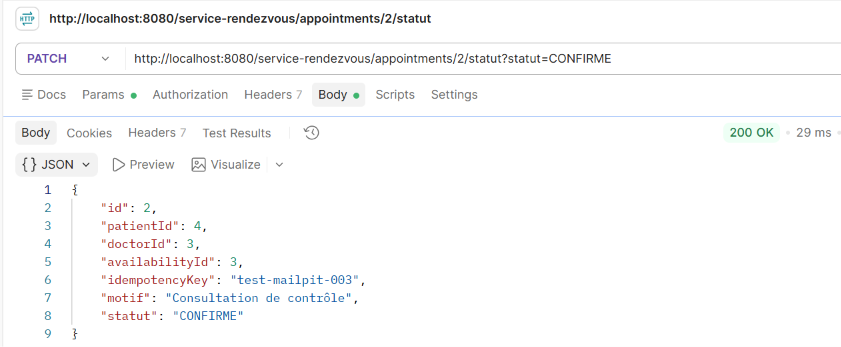

**2. Publication du message (Console Rendezvous):**

La console confirme que le message a été publié après le commit de la transaction dans la base de données.
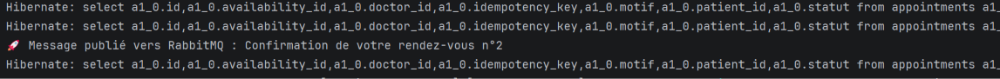

**3. Consommation et envoi de l'email (Console Notification):**

La console du service de notification montre la réception du message et la confirmation de l'envoi via le serveur SMTP.
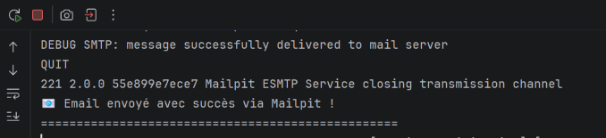

**4. Réception de l'email (Mailpit):**

L'email est bien reçu avec un design soigné (en-tête bleu Med-RDV), contenant le numéro du rendez-vous et le motif de la consultation.
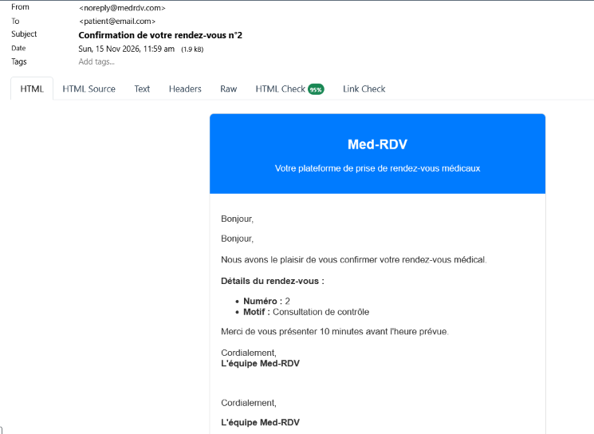

### 🧪 Tests des cas d'échec

**1. Échec de communication avec l'interface Mailpit**
Lors d'un test de rafraîchissement, l'interface web de Mailpit a affiché une erreur `Error sending data to the server`. Cependant, les emails étaient bien stockés et le service de notification a continué de fonctionner normalement, prouvant le découplage entre le service et l'interface d'administration.
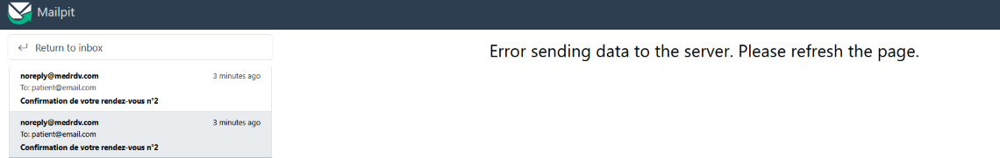
---

## Jalon V6 : Résilience, Gestion des Erreurs et Idempotence

Ce jalon ajoute des mécanismes de résilience (Circuit Breaker, Retry, Bulkhead, Cache) pour protéger les appels Feign, ainsi qu'un Rate Limiting sur la Gateway, une gestion centralisée des erreurs et l'idempotence des créations.

### 📦 Dépendances ajoutées

**Dans `service-rendezvous` :**
```xml
<dependency>
    <groupId>org.springframework.cloud</groupId>
    <artifactId>spring-cloud-starter-circuitbreaker-resilience4j</artifactId>
</dependency>
<dependency>
    <groupId>org.springframework.boot</groupId>
    <artifactId>spring-boot-starter-cache</artifactId>
</dependency>
<dependency>
    <groupId>com.github.ben-manes.caffeine</groupId>
    <artifactId>caffeine</artifactId>
</dependency>
```
**Dans `gateway-service` :**
```xml
<dependency>
    <groupId>org.springframework.boot</groupId>
    <artifactId>spring-boot-starter-data-redis-reactive</artifactId>
</dependency>
```
### 📸 Preuves de fonctionnement

**1. Comportement normal :**

Cette capture montre le fonctionnement nominal de l'application. On y voit la réponse 200 OK de l'endpoint GET /enriched avec toutes les données agrégées : les informations du rendez-vous, du patient (Dupont), du docteur (Dr. Martin) et du créneau. Cela prouve que les appels Feign fonctionnent correctement quand tous les services sont disponibles.
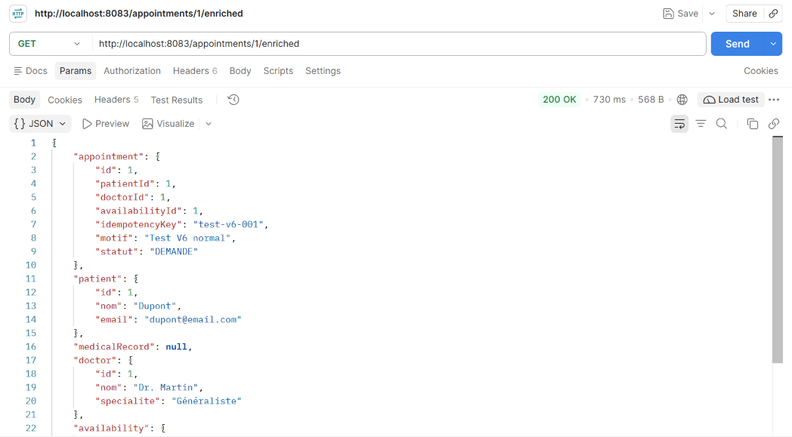

**2. Circuit Breaker (service patient éteint) :**

Cette capture prouve l'efficacité du Circuit Breaker. Le service service-patients a été volontairement éteint, et on voit que la requête POST /appointments renvoie immédiatement un code 503 Service Unavailable avec un message clair : "Le service des patients est momentanément indisponible. Réessayez plus tard.". Sans le Circuit Breaker, la requête aurait planté avec une erreur 500 ou aurait attendu un long moment.
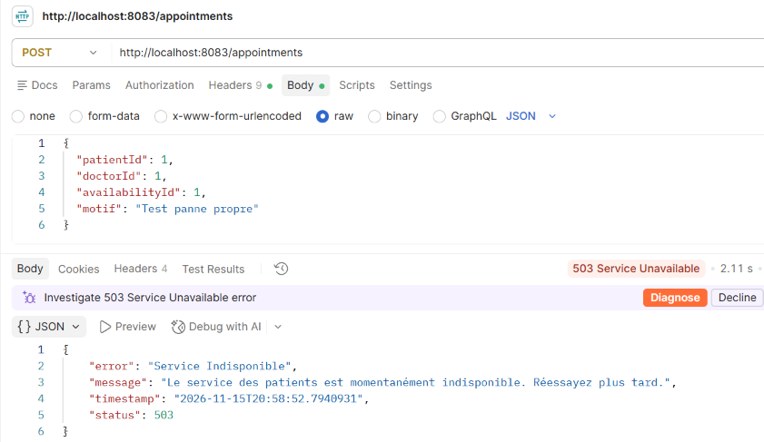

**3. Idempotence :**

Cette capture montre que l'idempotence fonctionne parfaitement. On y voit la réponse 200 OK d'un POST /appointments avec un rendez-vous existant (ID 3). La requête a été envoyée deux fois avec la même clé Idempotency-Key: 99991, mais le service n'a pas créé de doublon : il a renvoyé le rendez-vous existant. Cela garantit qu'un utilisateur qui clique deux fois sur "Réserver" ne créera qu'un seul rendez-vous.
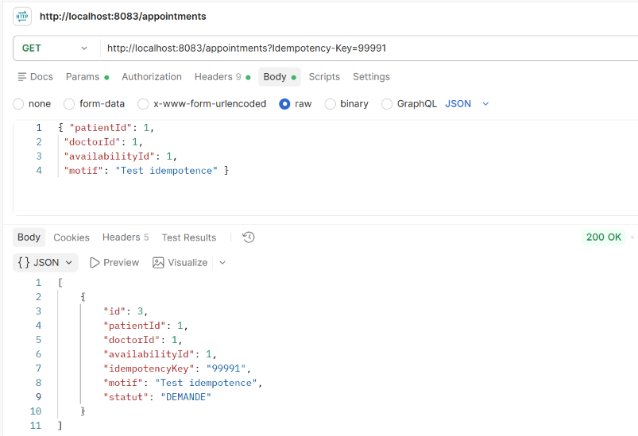

**4. Mode dégradé (Cache) :**

Cette capture illustre le mode dégradé. Alors que le service service-patients est éteint, la requête GET /enriched renvoie un code 200 OK. Les données du patient ("patient": {...}) sont toujours présentes grâce au cache Caffeine qui a été alimenté lors d'une consultation précédente. Si le cache était vide, le champ patient serait à null, mais la requête ne planterait pas. Cela prouve que la consultation reste disponible même en cas de panne partielle.
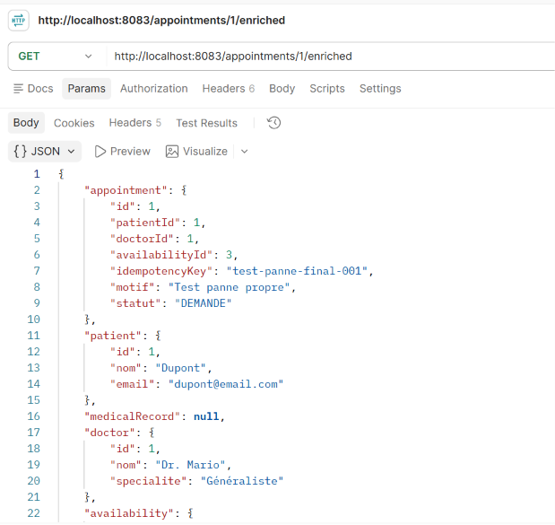

**5. ControllerAdvice (Erreur Métier) :**

Cette capture montre la gestion centralisée des erreurs. On y voit la réponse 400 Bad Request de l'endpoint GET /appointments/999 (un ID qui n'existe pas). Au lieu de renvoyer une grosse erreur 500 avec une StackTrace Java, le GlobalExceptionHandler renvoie un JSON propre et lisible.

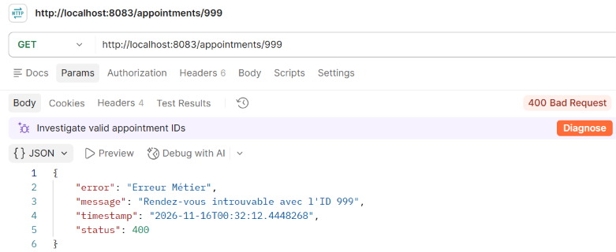

**6. Rate Limiting sur la Gateway :**

Cette capture prouve que le Rate Limiter de la Gateway fonctionne. On y voit les résultats de 20 itérations sur GET /appointments. Les premières requêtes passent en 200 OK, mais à partir de l'itération 11, les requêtes sont bloquées avec un code 429 Too Many Requests. Cela signifie que la Gateway a bien compté les requêtes dans Redis et a bloqué celles qui dépassaient la limite configurée (5 requêtes par seconde).
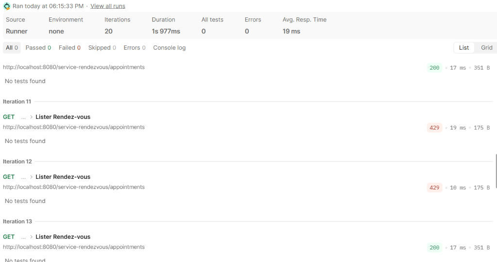


## Prérequis et Instructions de lancement

### Prérequis
*   Java 17 (JDK)
*   Maven 3.8+
*   IntelliJ IDEA
*   Postman

### Instructions de lancement
1. Cloner le dépôt : `git clone https://github.com/sondoustemri/MedRDV.git`
2. Ouvrir le projet dans IntelliJ IDEA et recharger les dépendances Maven.
3. Démarrer les applications dans cet ordre strict :
   1.  `eureka-server` (attendre qu'il soit prêt sur http://localhost:8761)
   2.  `config-server` (attendre qu'il soit prêt sur http://localhost:8888)
   3.  `service-patients`
   4.  `service-praticiens`
   5.  `service-rendezvous`
   6. `service-notification`
   7.  `gateway-service`